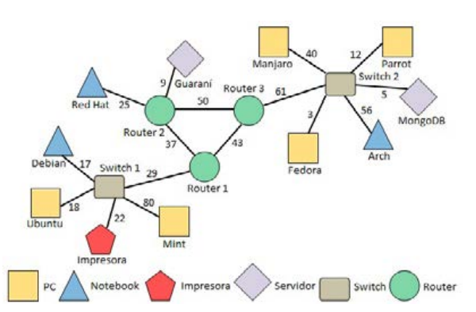

# Consignas del TP6 Grafos

### EJERCICIO 5:
Cargar el esquema de red de la siguiente figura en un grafo e implementar los algoritmos necesarios para resolver las tareas, listadas a continuación:

a. cada nodo además del nombre del equipo deberá almacenar su tipo: pc, notebook, servidor, router, switch, impresora;

b. realizar un barrido en profundidad y amplitud partiendo desde la tres notebook: Red Hat, Debian, Arch;

c. encontrar el camino más corto para enviar a imprimir un documento desde la pc: Manjaro, Red Hat, Fedora hasta la impresora;

d. encontrar el árbol de expansión mínima;

e. determinar desde que pc (no notebook) es el camino más corto hasta el servidor “Guaraní”;

f. indicar desde que computadora del switch 01 es el camino más corto al servidor “MongoDB”;

g. cambiar la conexión de la impresora al router 02 y vuelva a resolver el punto b;

h. debe utilizar un grafo no dirigido.

### EJERCICIO 14: 
Implementar sobre un grafo no dirigido los algoritmos necesario para dar solución a las siguientes tareas:

a. cada vértice representar un ambiente de una casa: cocina, comedor, cochera, quincho, baño 1, baño 2, habitación 1, habitación 2, sala de estar, terraza, patio;

b. cargar al menos tres aristas a cada vértice, y a dos de estas cárguele cinco, el peso de la arista es la distancia entre los ambientes, se debe cargar en metros;

c. obtener el árbol de expansión mínima y determine cuantos metros de cables se necesitan para conectar todos los ambientes;

d. determinar cuál es el camino más corto desde la habitación 1 hasta la sala de estar para determinar cuántos metros de cable de red se necesitan para conectar el router con el Smart Tv.
